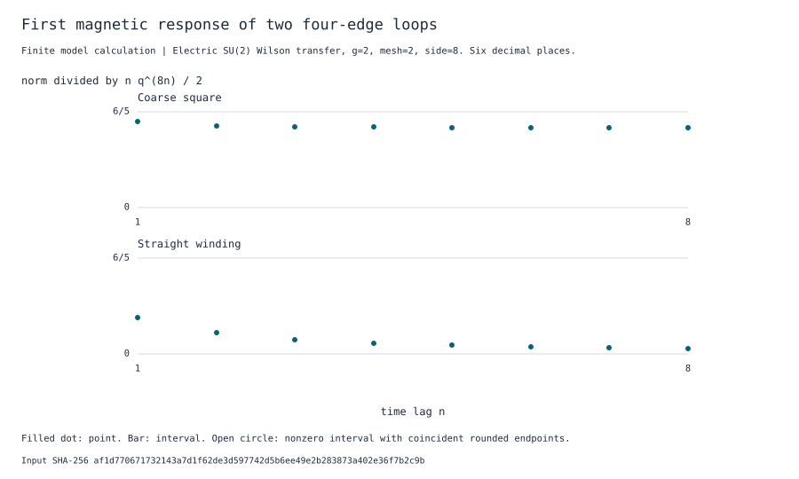

# Reproduction and scope

### All coarse states and the smallest torus

At temporal coupling $g=2$, mesh two and lag four, positive Bessel-series enclosures give the edge cutoff $K=8$ and the spin-index cutoff $J=5$ in the [finite reduction](optimizer.md). Enumeration on the $4^3$ coarse torus gives 192 contractible four-edge squares and 48 straight winding cycles. Each cycle has a one-dimensional intertwiner space for each of the five constant spin labels. This exhausts 1,200 connected input blocks after the analytic exclusions. At this lag the square norm is $4.7404838251\,10^{-12}$, the fundamental winding gives $6.4931217734\,10^{-13}$, and the largest higher-spin norm is $1.8370421650\,10^{-27}$. The cutoffs use rational Taylor enclosures with a positive tail bound. The displayed norms are floating-point evaluations of the two fusion channels. [Enumeration and interval arithmetic](spectrum.py)

| Temporal coupling $g$ | First lag satisfying sufficient condition (3), mesh 2 | Mesh 3 |
| ---: | ---: | ---: |
| 1 | 1 | 1 |
| 2 | 2 | 2 |
| 4 | 3 | 3 |
| 8 | 6 | 5 |

These are thresholds for the certificate. The first actual maximizing lag could be earlier. On the period-four torus the two basic loops have identical electric eigenvalues. Their different magnetic responses are visible in the normalized time dependence.



At $g=2$, $\ell=2$, the upper panel approaches one and the lower panel approaches zero. At $n=1$ the displayed square is one candidate. Condition (3) certifies it as the global maximizer from $n=2$ onward. The Rust PCP OS plotting host on the directors’ plotting branch rendered 16 points, recorded the SVG digest, and rejected an intentionally incorrect digest in its range instrument. [Rational plotting input](figures/comparison.json) · [Recorded rendering](figures/comparison.receipt.txt)

On the fine tori of sides 8, 12 and 16 with meshes 2, 3 and 4, respectively, all 1,536, 5,184 and 12,288 faces have distinct outside-skeleton center signatures. Checking all snapping offsets on the last coarse cube includes all translation types and edge and face seam crossings. Every surviving face image has the expected boundary and exactly $\ell$ offsets preserve that face. [Cubical enumeration](geometry.py)

### Independent finite transfers

A binary tetrahedral control reconstructs the moving normalized transfer from its positive vacuum and conditions on the complete conjugacy class of the long loop. One graph has a length-eight and a length-four loop sharing a link, with the magnetic weight on the short loop. The test uses all seven complex irreducible coarse characters and every fine orbit. Two disjoint copies have 5,776 physical orbit pairs and 49 coarse columns including the vacuum. At $g=4,n=2$ the single and double graph norms were both $0.00033336263582$. The largest off-diagonal entry of the measured weighted input Gram matrix had magnitude $2.54\,10^{-18}$. The test varies the actual vacuum and the conditional projection at both signs of the field. A separate finite-coupling minimization in the same model gives $1.11130646\,10^{-7}$ for the [fractional energy-loss coefficient](energy.md), agreeing with the squared derivative norm. This finite-group graph tests the slot normalization, spectral weights, spectators and the minimizing extension. The cubic $SU(2)$ proof also needs its spatial face geometry and spin-channel estimates. [Transfer implementation](nonabelian.py)

For the [vacuum sheet](area.md), the following are exact coefficients from the finite subset recurrence. The $q=1/2$ column uses normalized $SU(2)$ traces. The continuous-time column uses the coefficient in $j$ with $\kappa=1$ at fixed spatial lattice.

| Rectangle | Coefficient at $q=1/2$ | Continuous time |
| --- | ---: | ---: |
| $1\times1$ | $17/60$ | $1/12$ |
| $2\times1$ | $6197/75600$ | $7/864$ |
| $2\times2$ | $11765309977/1651739040000$ | $35/373248$ |

An exact independent stationary-vacuum perturbation for a binary gauge group through fourth order agrees with the **height sum** at $q=1/2,2/3$ on these three shapes. In the binary case the loop and face characters are signs. The $SU(2)$ disk contributes the additional factor $4^{-m}$. On the quaternion subgroup the static two-insertion Gram contraction is exactly $1/128$ under enumeration of $8^4$ disk holonomies. [Rational controls and larger square](sheet.py)

For an independent **nonabelian four-tile** test, the program fixes a tree on the nine spatial vertices of the $2\times2$ disk, leaving four quaternion-valued links. All 12 physical links carry independent electric Haar refreshes with probability $1-q$ per step. Thus the fundamental propagates with the required eigenvalue. The magnetic weight is the normalized fundamental trace. The program perturbs the actual stationary vacuum, dividing by its norm at each order, in both discrete and continuous time. The reduced inverse is built from the commuting physical-link Haar projections. The program checks its defining linear equation on every vector it solves for. The first three loop coefficients vanish. The degree-four coefficients agree with the predicted rationals in two prime fields, as shown below. It also verifies the half-endpoint weights on a three-time-slice window separately. These exact residue checks use a finite nonabelian model with its specified link law. The full $SU(2)$ identity follows from the sheet contractions and the vacuum limit. [Direct nonabelian calculation](nonabelian.py)

| Electric dynamics | Residue mod 1013 | Residue mod 10007 |
| --- | ---: | ---: |
| $q=1/2$ | 997 | 1118 |
| $q=2/3$ | 629 | 655 |
| Continuous time, $\kappa=1$ | 893 | 914 |

### Research comparisons

A4 requested an independent check that face and label orthogonality survives the inverse electric defect. Both projectors commute with the transfer. The private-edge integral gives the factor-of-two improvement, and the period-four winding calculation tests the tie left by the electric spectrum. A4’s later three-slice composition defect measures the unweighted residual, which is compared quantitatively with the effective Dirichlet energy here. B4’s distinct height sum uses two marked faces and a six-face cube in a quartic **gap** calculation. Both calculations use the electric propagation on shared links. [A4’s full-space result](../../../observable-normalization/transfer-increments/electric-lag/all-coarse/README.md) · [A4’s memory result](../../../observable-normalization/transfer-increments/electric-lag/coarse-memory/README.md) · [B4’s cube result](../../../transfer-operator/blocked-time/magnetic-curvature/quartic/cube/README.md)

Z4’s third revision retains the conditional reduction and records the scope of the chessboard and tail checks. G4 instead fixes an external time scale and tests energy coercivity after minimizing over every finer reading. The calculations bound the magnetic derivative at an anisotropic endpoint and identify the first parity collision at higher order. They leave the isotropic continuum lower gap and field construction open and supply no contradiction to Z4’s conditional implications. [Z4’s revision record](https://github.com/KirtusJ/Millennium-Prize-Problems/blob/dcdc744fa3ff101276c6953c37a6e73e32b04e44/yang-mills/z4/attempt/paper/CHANGES_revision3.md) · [Original fixed-scale proof attempt](../README.md)

### Formal checks and replay

The [Lean source](AllReadings.lean) establishes seven algebraic statements. They cover the normalized channel identity, the two-component and arbitrary-list spectator budgets, the list product interval, the projection-count inequality, the height recurrence rearrangement, and completion of the fine energy square. The fixed-graph representation theory, physical transfer derivative, finite-box analytic continuation, optimizer classification, and least-sheet theorem are proved in the accompanying mathematics. The hosted compiler used Lean 4.19.0 and Mathlib at commit `c44e0c8ee63ca166450922a373c7409c5d26b00b`. Its seven axiom reports contain only the standard logical axioms. Five deliberately false variants fail. During development the list-product lemmas required an explicit import. [Adverse variants](mutations.json)

Seven research or formalization builders each ran under a recursive PCP commission with a separate challenger. Four additional commissions challenged the exact deposited mathematics and its transfer inputs. The records include the prompts, readbacks and process exits. These reviews share a model provider. The independent controls above use different calculations. The native Enterprise kernel replayed six packet and capability cases and emitted the full Lean source in three fragments. The hosted compiler checked that source. The kernel hash, register heads, source and figure digests, and archived control outputs are checked by the verifier. [Evidence archive](evidence.zip) · [Verifier](verify.py)

Run the following from this directory with Python and NumPy. The second command runs in a Mathlib checkout at the pinned commit with Lean 4.19.0.

```text
python -B verify.py
lake env lean /absolute/path/to/AllReadings.lean
```

For deep replay, add options `--runtime /path/to/PCP_OS_Python --method /path/to/PCP/Method` to the Python invocation. Supplying `--plot-host /path/to/pcpos` also re-renders the figure and tests the incorrect digest. The hosted method packet contains 58 files, release `7ff72eed9162e2c11fc62f6681c4afbc29524bfa96b87d45a455423d027d4707`. The native kernel digest is `d2fae4ef3df316ff4fa0c1a88744e66cc17bd794856979fa55188b8402f7222f`. The plotting host was built at `e8d62e4` on the separate PCP OS plotting branch. [External Wilson transfer construction](https://doi.org/10.1007/BF01614090) · [Official prize statement](https://www.claymath.org/wp-content/uploads/2022/06/yangmills.pdf)
