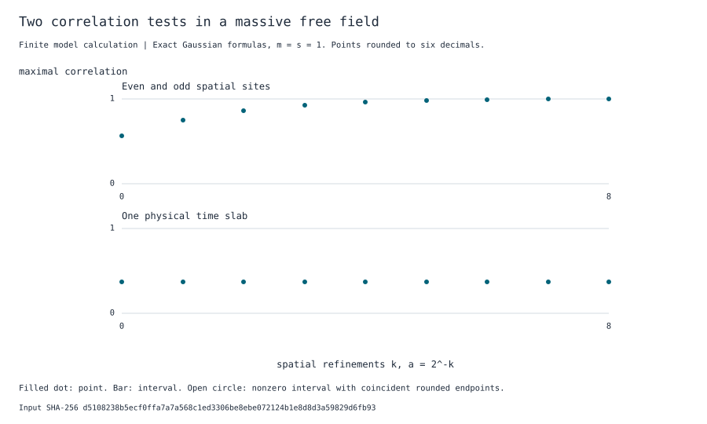

# A local repair, its counterexample, and a second repair

For stationary slices $X,Y$ at a fixed time separation define the centered maximal correlation as the supremum of $|\mathbb E[f(X)g(Y)]|$ over real centered unit $L^2$ functions. On a physical slice this equals the norm of the vacuum Markov operator $K$ on $L^2_0$. Also
$$
 1-\|K\|_0^2=\inf_{f:\,\mathrm{Var}_\pi f>0}
       \frac{\mathbb E\,\mathrm{Var}(f(Y)\mid X)}{\mathrm{Var}_\pi f}.
$$
This follows from total variance. For independent component channels maximal correlation is the maximum of the component correlations. The tensor product of the constants and centered subspaces proves this directly for self-adjoint contractions. This behavior explains the difference from whole-slice total variation. [Witsenhausen’s product theorem](https://doi.org/10.1137/0128010) · [Electric calculation](electric.md)

### First repair by alternating spatial updates

Let $P_A,P_B$ be conditional expectations on two spatial subsets, acting on centered $L^2$ of the terminal slice, and $r=\|P_AP_B\|$. For $u,v$ in the ranges of $P_A,P_B$, respectively, $|\langle u,v\rangle|\le r\|u\|\|v\|$. Hence the map $(u,v)\mapsto u+v$ has squared norm at most $1+r$. Apply its adjoint to $f$ to obtain $\|P_A f\|^2+\|P_B f\|^2\le(1+r)\|f\|^2$. If the conditional variance across the time slab dominates $\kappa$ times the variance remaining after conditioning on either subset, then adding the two comparisons gives $1-\|K\|_0^2\ge\kappa(1-r)/2$. A tempting proof would take the subsets to be alternating fine sites and use a fixed $r<1$ on every refinement.

Consider a massive free real scalar in continuous time on a three-dimensional periodic spatial grid, with even side, spacing $a$, mass $m>0$, and one-particle frequency $\omega(k)=(m^2+4a^{-2}\sum_i\sin^2(k_i/2))^{1/2}$. The equal-time covariance is $1/(2\omega(k))$. On the even and odd sites a mode at $k$ aliases with $k+(\pi,\pi,\pi)$. The two retained combinations are the sum and difference of the pair. Their absolute canonical correlation is $|\omega(k)-\omega(k+\pi\mathbf1)|/(\omega(k)+\omega(k+\pi\mathbf1))$. Orthogonal real Fourier coordinates decompose the whole pair into independent Gaussian channels. For one canonical channel the Hermite basis has eigenvalues $1,\rho,\rho^2,\ldots$, by the Gaussian generating function. Taking products gives the same maximum over all centered nonlinear tests. The extremal pair is the zero mode and the corner of the Brillouin zone, which realize the smallest and largest possible frequencies. Consequently
$$
 r=\frac{\sqrt{m^2+12/a^2}-m}{\sqrt{m^2+12/a^2}+m}\longrightarrow1.
$$
The true time-slab correlation norm at physical separation $s$ is $e^{-ms}$ at every spatial cutoff by the oscillator semigroup and the same Hermite calculation. Here time is continuous. A nearest-neighbor discretization in time changes the finite-cutoff frequency. The degenerating checkerboard inequality is an actual failure of the proposed uniform spatial-angle premise in a reference theory with a positive mass. [Numerical mode check](controls.py)

The panels use the same vertical scale, $m=s=1$, and spatial spacings $2^{-k}$. Each point is a rounded evaluation of the displayed Gaussian formulas. [Figure inputs and reproducibility](execution.md#figure)

### Second repair by resolving physical modes

Keep the same time transfer throughout. In a Wilson slice choose nested sigma algebras of gauge-invariant spatial readings. A concrete choice on dyadic boxes uses the gauge-orbit data for all straight blocked links of meshes $2^j a$, obtained by multiplying fine links along exact segments. Coarser orbit data are functions of finer orbit data. Add successively finer grids, including the full physical slice last. Meshing must include macroscopic loops and global flux sectors in the coarsest/detail decomposition. For general compact groups, complete orbit data avoid an assumption that a chosen finite list of traces separates all orbits. Use conditional expectations $P_j$ in the **actual** vacuum probability and restrict to centered functions. Set $D_0=P_0$, $D_j=P_j-P_{j-1}$ in order from coarse to fine. They are orthogonal projections summing to the identity on the chosen physical space. These projections need not commute with transfer.

Write $S=K^{n(a)}$, and let $f_j=D_j f$. It would suffice to prove positive numbers $d_j$, with $d_j\ge d_*>0$, and symmetric nonnegative numbers $w_{ij}$ with zero diagonal such that
$$
 \langle f_j,(I-S)f_j\rangle\ge d_j\|f_j\|^2,\qquad
 |\langle f_i,Sf_j\rangle|\le w_{ij}\sqrt{d_id_j}\|f_i\|\|f_j\|\quad (i\ne j),
 \qquad \sup_i\sum_{j\ne i}w_{ij}\le\eta<1.                 \tag{2}
$$
The off-diagonal sum is at most $\eta\sum d_j\|f_j\|^2$ by $2xy\le x^2+y^2$ in the weighted double sum. Thus $I-S\ge (1-\eta)d_* I$. The even-slab operator is positive, so this gives the upper contraction needed in the [construction](construction.md). The finite-sum inequality is in [Lean](FullAttempt.lean). The bounds in (2) refer to bilinear forms of the original transfer. In general $(P_j K P_j)^n\ne P_jK^nP_j$.

On the free control a hierarchy that reveals Fourier modes from low to high gives (2) with all $w_{ij}=0$. Fock/Hermite states first seen at level $j$ contain an excitation in the added band. Their transfer norm is at most $\exp[-s\min_{k\ \mathrm{added}}\omega(k)]$, also when they contain lower-band excitations. The lowest nonconstant band has norm $e^{-ms}$. This verifies the sufficient implication on a nontrivial continuum model. The Fourier projection here uses the known quadratic Hamiltonian. Local Wilson orbit data are different projections and their off-diagonal matrix elements require estimates.

### What would decide the Wilson estimate

At a fixed external physical thickness measure the covariance of centered normalized functions from each pair of resolution spaces, including observables supported in rare large-curvature events. Proving (2) requires **upper** bounds over all such functions, a summable bound as the number of levels grows, and coercivity on the coarsest sector. A sequence of longer and longer-lived gauge-invariant vectors with Rayleigh quotients tending to one at this physical separation would refute the uniform slab estimate itself on that regulator trajectory. Divergence of a bound on $w_{ij}$ would instead defeat that particular sufficient comparison.

There is an exact four-state Markov control for the hidden-sector problem. Take two independent stationary fair signs $X,Y$ with one-step autocorrelations $1/2$ and $1-2\epsilon$, where $0<\epsilon\le1/8$. Each sign flips with probability half its correlation defect. The product transfer has full centered gap $2\epsilon$. The normalized observable $F=\sqrt{1-\epsilon^2}\,X+\epsilon Y$ has nonzero overlap with the slow state, yet its autocorrelation differs from $2^{-n}$ by at most $\epsilon^2$ at **every** lag $n$. With $\epsilon=e^{-\beta}/8$, even exponentially accurate absolute control of a measured curve can hide a closing gap. This control isolates the quantifier over states in (2). The Wilson measure still has to be tested on its own state space. [Transition-matrix check](controls.py)

The previously derived fixed-lag Ward estimates and positive limiting weights for some magnetic bands provide observations on specified tests. An indicator of an event of probability $p>0$ has normalized $L^2$ version $\mathbf1_E/\sqrt p$ and the multiplication projection has norm one however small $p$ becomes. Probabilistic suppression alone gives no operator-norm bound on the discarded events. The spatial magnetic expansion gives explicit cancellation for neighboring sectors at order two. It has yet to give the coarse coercivity, an estimate for off-diagonal leakage, or convergence of all local fields on the physical trajectory. [G4’s actual isotropic Wilson test](../spatial-block-criticality/README.md) · [Magnetic derivative](magnetic.md)
