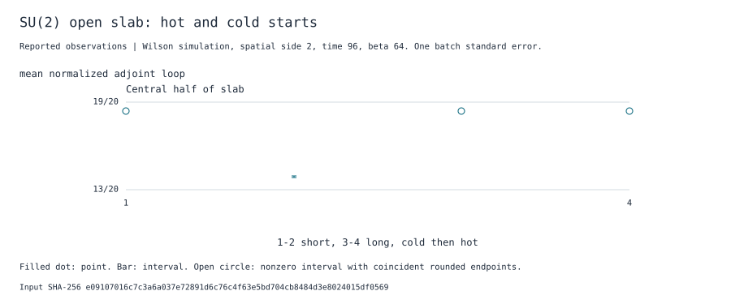

# Vacuum-subtracted Wilson measurements

Twenty-six independent seeded chains evaluated the nonlinear isotropic $SU(2)$ Wilson action, with 114,752 discarded and 104,192 retained sweeps. Each sweep consisted of a complete single-link heat bath followed by a complete microcanonical reflection. The lattice has distinct oriented links even for spatial side two. Every chain checks the full-action change of a replaced link, action invariance under a reflection sweep, and invariance of all three observables under site gauge rotations and a spatial center cut. [Simulator](wilson_mc.rs) · [Creutz, SU(2) simulations](https://doi.org/10.1103/PhysRevD.21.2308) · [Creutz, overrelaxation](https://doi.org/10.1103/PhysRevD.36.515)

On an open slab of $T$ slices, omit wraparound time faces and half weight spatial faces on each time boundary. Independent Haar integration at both endpoints gives $\langle1,T_{\rm W}^{T-1}1\rangle$. The constant state and all our probes are invariant under gauge transformations and the three spatial center generators. Every propagation interval therefore lies in the neutral sector. Six additional periodic-time chains check the analysis under ordinary thermal trace boundary conditions, which also admit charged sectors. For each link the sampler uses its full signed staple. At large staple strength $\kappa$, propose $x\sim\mathrm{Gamma}(3/2,1)$, accept with probability $\sqrt{1-x/(2\kappa)}$ on $[0,2\kappa]$ and set the sampled quaternion scalar to $1-x/\kappa$. This produces the required tilted $S^3$ density. An ordinary Haar rejection step covers $\kappa<1$.

The three slice observables are the mean spatial half-trace plaquette, the scalar average of the normalized adjoint winding traces, and their direction-one minus direction-two difference (a cubic tensor component). Each adjoint trace is $(4q_0^2-1)/3$. Open-slab products average all origins for which **both** endpoints lie in the central half. The disconnected contribution is the average of the separate ensemble means at the two individual slice indices. Axis exchange makes the tensor mean exactly zero. The recorded effective decay is $\log[C(2)/C(3)]$ in lattice units. Short time, finite slab thickness and overlap with higher states all affect it.

| Spatial box | Time slices | $\beta$ | Tensor effective decay | Adjoint scalar effective decay |
|---|---:|---:|---:|---:|
| $2^3$ | 48 | 4 | 0.688 ± 0.025 | 0.794 ± 0.051 |
| $2^3$ | 48 | 16 | 0.567 ± 0.013 | 0.672 ± 0.020 |
| $2^3$ | 64 | 64 | 0.376 ± 0.012 | 0.435 ± 0.012 |
| $2^3$ | 96 | 64 | 0.366 ± 0.008 | 0.455 ± 0.007 |
| $4^3$ | 48 | 4 | 0.287 ± 0.014 | 0.383 ± 0.037 |
| $4^3$ | 48 | 16 | 0.261 ± 0.010 | 0.324 ± 0.018 |
| $4^3$ | 80 | 16 | 0.240 ± 0.014 | 0.312 ± 0.021 |

The uncertainties are one delete-batch jackknife standard error, combining four adjacent recorded blocks per batch within a stream. The replay also reports one- and eight-block groupings, both starts separately, all lags zero through six, and the plaquette measurements. Several plaquette log ratios or their leave-one-out replicas are undefined or have very large uncertainty. The table uses the longer independent reruns for $2^3$, $(T,\beta)=(48,16),(96,64)$.

**A failed thermalization test materially changed the numbers.** At $2^3\times96$, $\beta=64$, the short cold and hot runs gave central adjoint means 0.91981 and 0.69464. Pooling them produced an apparent scalar decay $0.0384\pm0.0040$. The discrepancy between starts invalidates that reading. After 30,720 discarded and 8,192 retained sweeps for each of two fresh starts, the means were $0.91973\pm0.00031$ and $0.91922\pm0.00031$, and their scalar decays were $0.459\pm0.011$ and $0.451\pm0.010$. At $2^3\times48$, $\beta=16$, another short pair failed. After 15,360 discarded sweeps per fresh start the means agreed at 0.78302 and 0.78309. The first runs remain in the archive as failure controls. Agreement of the longer runs and blocking checks does not supply an equilibration proof. [All block means and time-resolved subtractions](wilson-blocks.zip) · [Analysis and plot inputs](measurements.py)

The four plotted intervals are the separate start estimates with one batch error at $2^3\times96$, $\beta=64$. Three intervals round to less than one vertical display pixel. The native plot specification records all interval endpoints. [Plot inputs](figures/starts.json) · [PCP OS rendering receipt](figures/starts.receipt.txt)

**Independent controls.** At $\beta=0$, Haar independence predicts spatial-slice variances $1/(12L^3)$, $1/(27L^2)$ and $2/(9L^2)$ for the plaquette, scalar and tensor, and zero lag-one correlation. At $L=2$ the respective measured variances were $0.010402\pm0.000053$, $0.009236\pm0.000042$ and $0.05554\pm0.00022$. The lag-one plaquette estimate was $-0.000072\pm0.000030$. Its deviation illustrates the variation across the several null tests. At $\beta=4,16$, changing volume visibly changes the resolved tensor decay. None of these measurements bounds the entire low spectrum, and there is no scale-setting observable or thermodynamic extrapolation in this data set.

**Replay.** Build with `rustc -O wilson_mc.rs`. Use arguments `L T beta seed hot burn_blocks production_blocks sweeps_per_block open|periodic`. For example, the longer hot $2^3\times96$ run uses `2 96 64 1304 1 480 128 64 open`. Each archived CSV name supplies the full argument set and start type. Run `python measurements.py summary.csv` for the tables. Compiler and platform floating-point functions can change individual long Markov trajectories.
